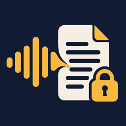
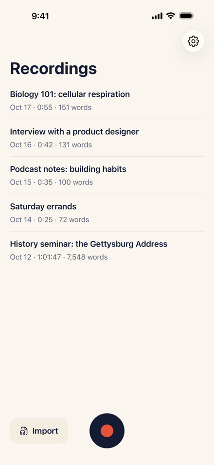
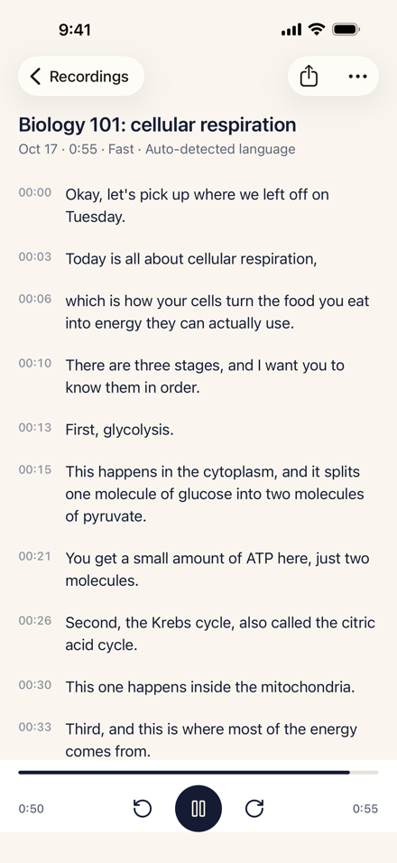
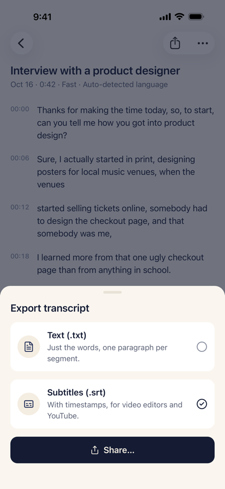
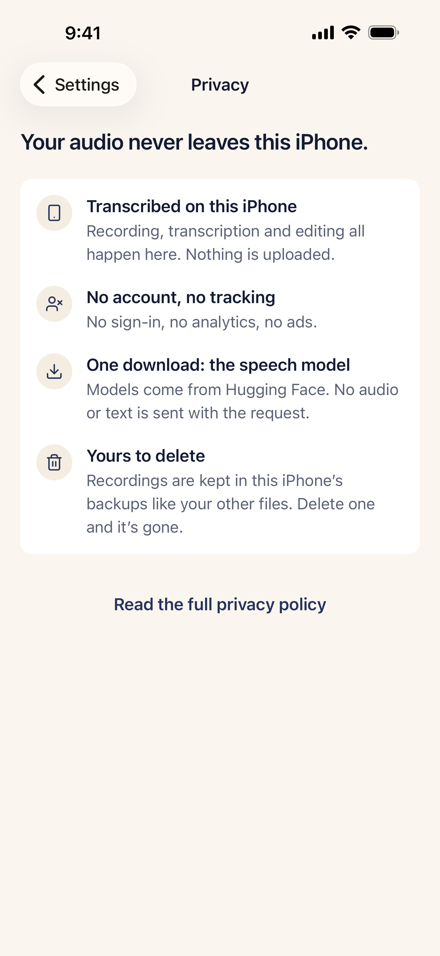

  

<h1 align="center">Hushscribe</h1>

  <b>Offline transcription for iPhone.</b> Record or import audio, get text you can edit and export. 
  It all runs on your iPhone. Nothing is uploaded.

  <a href="https://apps.apple.com/app/id6823783861"><b>Download on the App Store</b></a> ·
  <a href="https://hushscribe.soakout.com">Website</a> ·
  <a href="https://hushscribe.soakout.com/privacy">Privacy</a>

  
  
  
  

---

## What it does

- **Record or import.** Record a class, a meeting or a voice memo; it keeps recording with the screen locked. Or bring in m4a, mp3, wav, aac, caf, mov and mp4 from the Files app or another app's share sheet.
- **Transcribe on device.** An open-source Whisper model runs on the iPhone. On an iPhone 16 Pro Max the Fast model does about 50× real time, roughly 70 seconds for an hour of audio.
- **Edit and export.** Tap any line to hear that moment again, fix a word, and it saves as you type. Export plain text or `.srt` subtitles with timestamps, edits included.

Made for lectures, interviews and subtitles for your own videos. 100 languages, detected automatically.

## Privacy

- No account, no cloud, no upload. The App Store label reads **Data Not Collected**.
- The only network use is the one-time model download (57 MB for Fast, 181 MB for Accurate) and the App Store purchase.
- After that it works in airplane mode.

## Free and paid

The first 3 transcriptions are free, export included. Then **$7.99 once** for unlimited transcriptions. No subscription, no per-minute fees. Restore your purchase from Settings on a new iPhone.

## Requirements

iPhone with iOS 17 or later. It also opens on iPad in iPhone compatibility mode.

## Feedback

Found a bug or want a feature? [Open an issue](../../issues/new). For anything private, write to [service@worldmetric.cn](mailto:service@worldmetric.cn).

---

Hushscribe is closed source. This repository holds the public issue tracker and release notes.
Speech recognition uses [whisper.cpp](https://github.com/ggml-org/whisper.cpp) and OpenAI Whisper model weights, both MIT licensed.
